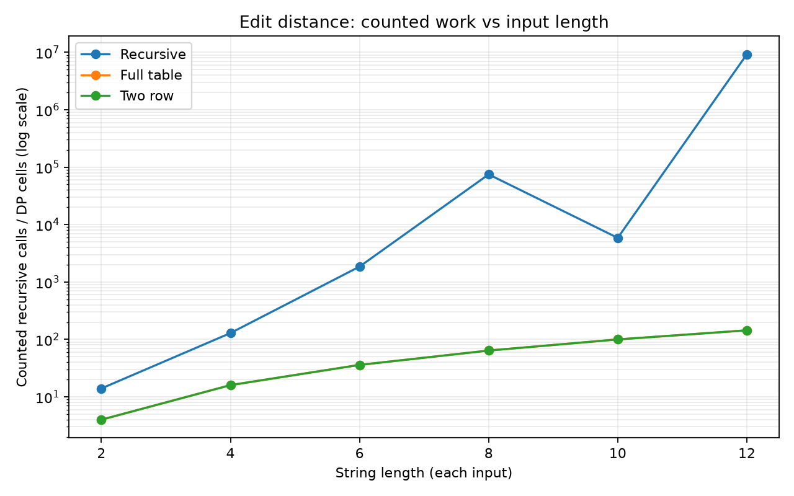
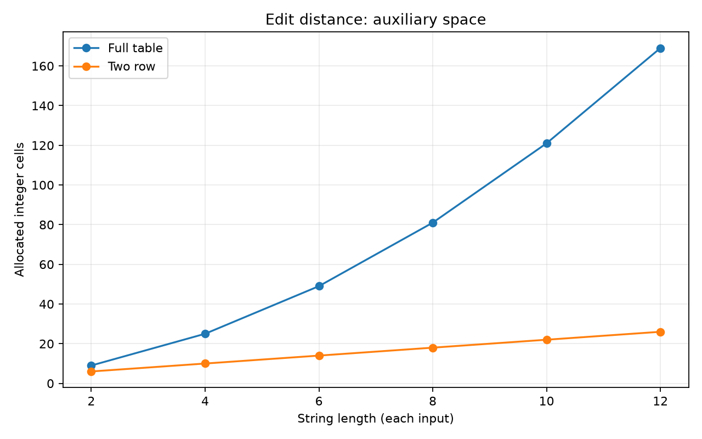
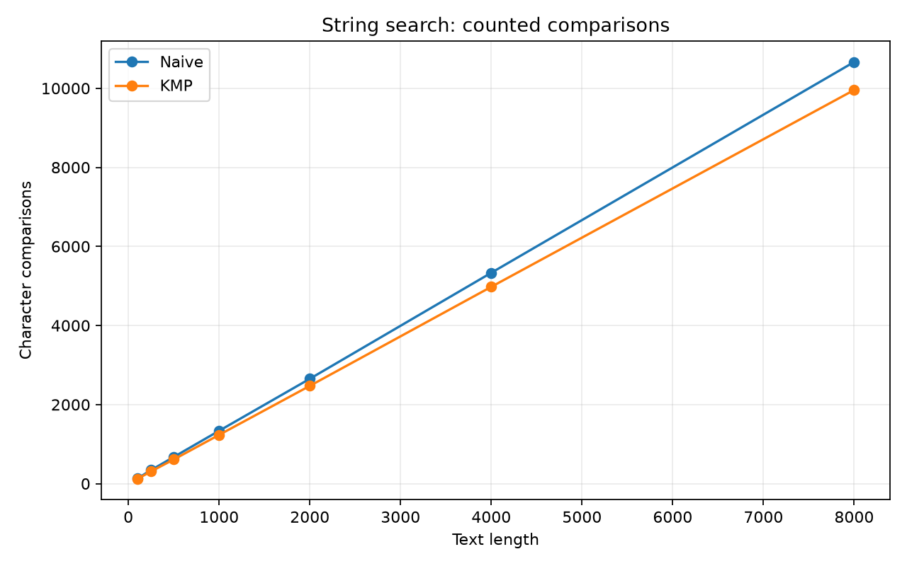
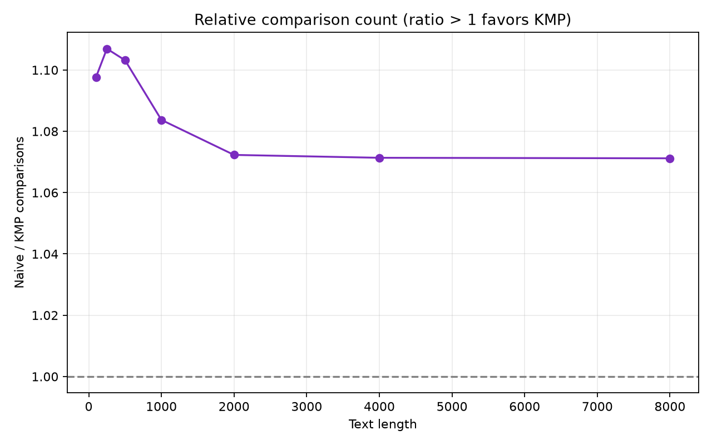

# Assignment 4 Report: Dynamic Programming and String Algorithms

**Student:** Nishchay Shergill  
**Group:** `[GROUP NAME / NUMBER]`  
**Environment:** Java 17, Maven; deterministic generator seed `20260404` (edit distance) and `20260405` (string search)

## Experiment design card

| Field | Design |
|---|---|
| Question | How do three edit-distance implementations compare in work and auxiliary space, and how do Naive and KMP search compare in text comparisons? |
| Independent variables | Edit-distance input length (2–20); search text length (100–8000); algorithm choice |
| Controlled variables | Alphabet `a`–`d`; deterministic seeded generator; same input pair/text-pattern for algorithms within each trial; same JVM process and machine |
| Trials | Three seeded pairs per edit-distance length; five text-pattern pairs per search length |
| Measurements | In-algorithm calls/cells/comparisons, allocated integer slots for DP, and elapsed nanoseconds |
| Reproducibility | Run `mvn -q -DskipTests compile exec:java`; fixed seeds and sizes are in `ExperimentRunner.java` |
| Limits | Recursive lengths stop at 12 because the naive recurrence grows exponentially. Timings are one-shot and vulnerable to JIT, GC, and OS noise. |

## Predictions

1. The recursive edit-distance call count will grow much faster than either DP implementation because it recomputes overlapping subproblems. The recurrence has exponential worst-case growth.
2. Full-table and two-row edit distance will compute the same number of interior cells, Θ(mn). Two-row storage will use Θ(min(m,n)) integers, compared with Θ(mn) for the full table.
3. On random small-alphabet text, KMP will usually need fewer character comparisons than Naive as text length grows. KMP's text scan is linear; Naive may repeatedly compare a long prefix. The generated pattern is short, so the gap may be modest and can vary by sample.

## Results

The checked-in `results.csv` contains all raw generated trials (112 algorithm-case observations). Use the arithmetic mean of each group's operation counts when comparing trends; the figures plot those means. Timings are included for completeness but are too noisy to support precise conclusions from this small, single-run experiment.

### Edit distance

- The two DP variants returned the same distance for every generated pair and each evaluated `m × n` interior states. In these square cases that is `n²` cells.
- The full table reserved `(m+1)(n+1)` integer slots. The two-row implementation reserved `2(min(m,n)+1)` slots; it retains only the previous and current row.
- Mean recursive calls for lengths 2, 4, 6, 8, 10, and 12 were 14, 129, 1,854, 74,786, 5,867, and 9,229,615. The irregular length-8/10 step reflects input-dependent matches and branch pruning; the overall growth is still much steeper than the DP curves. Length 12 is deliberately the upper bound so the experiment stays practical.

### String search

- Both algorithms returned the same match indices, including overlapping matches. The seeded texts include inserted known occurrences.
- Naive search tests each candidate alignment and may re-check a matched prefix. KMP uses the LPS fallback to avoid moving the text index backward. The ratio plot makes relative comparison counts explicit; values above 1 mean Naive used more comparisons.
- Mean comparisons (Naive vs KMP) at text lengths 100, 250, 500, 1,000, 2,000, 4,000, and 8,000 were 130 vs 119, 342 vs 309, 674 vs 611, 1,336 vs 1,233, 2,652 vs 2,473, 5,333 vs 4,978, and 10,665 vs 9,956. KMP's advantage is modest on these short patterns, as predicted. Counts are deterministic for the fixed seed; elapsed time should be treated as noisy.

## Short answers

### 1. Why is dynamic programming more efficient than the recursive edit-distance solution?

The recurrence has overlapping subproblems: many branches ask for the same prefix-pair distance. Plain recursion recomputes those values, which causes exponential work in the worst case. Dynamic programming computes each prefix pair once, yielding Θ(mn) time.

### 2. What is the space trade-off between the full table and two rows?

The full table uses Θ(mn) space and keeps every subproblem value, which is useful if the table or reconstruction information is needed. The distance-only two-row version uses Θ(min(m,n)) space while retaining enough information to calculate the next row. It returns the distance but does not preserve the complete table for later reconstruction.

### 3. How does KMP avoid redundant comparisons?

When a mismatch occurs after a partial match, KMP uses the LPS value to shift the pattern to the longest prefix that is also a suffix of the matched portion. It keeps the already-scanned text position and avoids rechecking characters that the prefix structure proves must match.

### 4. Why can Naive still be useful?

It is short, easy to inspect, and can be competitive for very small patterns or texts. It is also a useful correctness baseline. Its worst-case comparison count is Θ((n−m+1)m), while KMP's search phase is Θ(n+m), including preprocessing asymptotically.

## Interpretation and limitations

Operation counts directly expose algorithm work; wall-clock timings here use only one invocation per case and no warm-up or repeated timing harness. This means time plots are intentionally omitted in favor of reproducible counters. The random alphabet and short pattern lengths represent one workload, not every search workload. The counters follow the definitions in the README, particularly excluding KMP LPS preprocessing comparisons.

## AI-use acknowledgement

AI assistance was used to draft and organize parts of the code, tests, experiment tooling, and report. The student should validate and understand the submission and follow the instructor's AI-disclosure policy.
